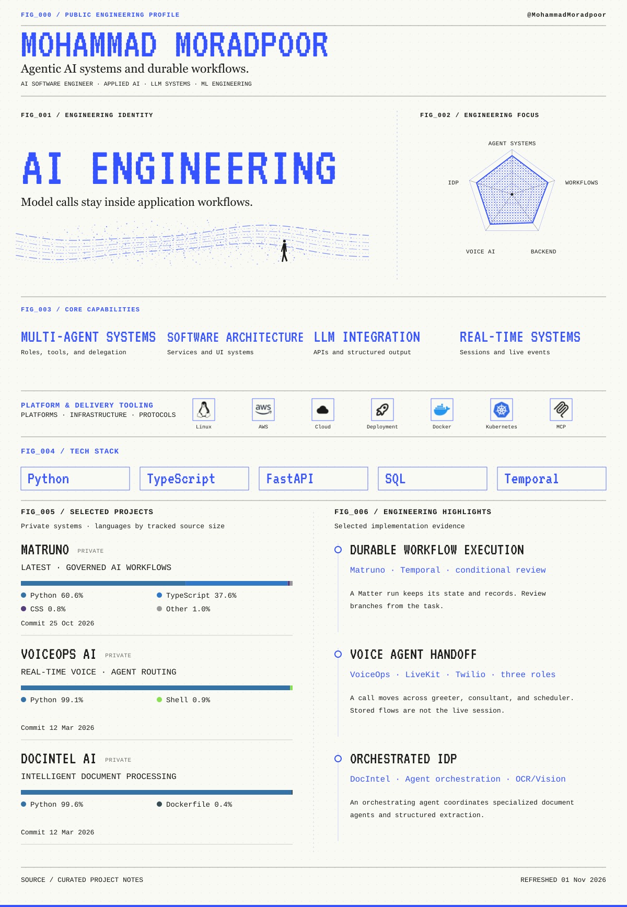
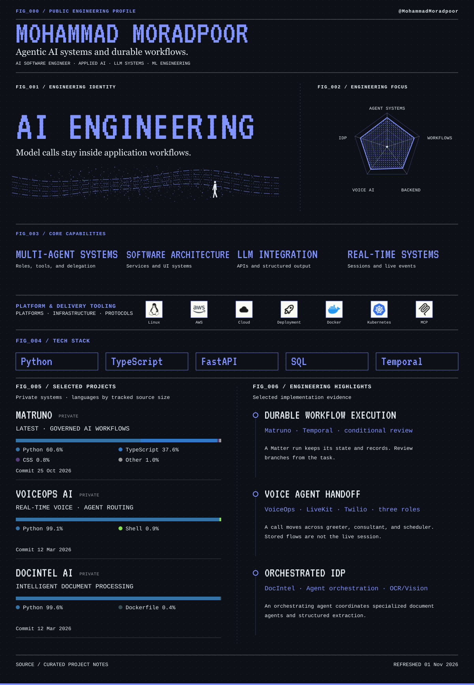

**Mohammad Moradpoor** — AI Software Engineer. Agentic AI systems and durable workflows.

Flagship product: [Matruno](https://www.matruno.com/), a private legal-operations platform. VoiceOps AI and DocIntel AI are architecture summaries of private systems. Their source is not public.

Public code: [medical-ai-analyzer](https://github.com/MohammadMoradpoor/medical-ai-analyzer)

<a href="./assets/public-builder-profile.png#gh-light-mode-only">
<picture>
  <source media="(max-width: 600px)" srcset="./assets/public-builder-profile-mobile.png" />
  
</picture>
</a>
<a href="./assets/public-builder-profile-dark.png#gh-dark-mode-only">
<picture>
  <source media="(max-width: 600px)" srcset="./assets/public-builder-profile-mobile-dark.png" />
  
</picture>
</a>

[LinkedIn](https://www.linkedin.com/in/mohammad-moradpoor) · [All repositories](https://github.com/MohammadMoradpoor?tab=repositories)

The image is generated from curated project notes and public GitHub data. <a href="./RANKING.md">Sources and methodology</a>.
